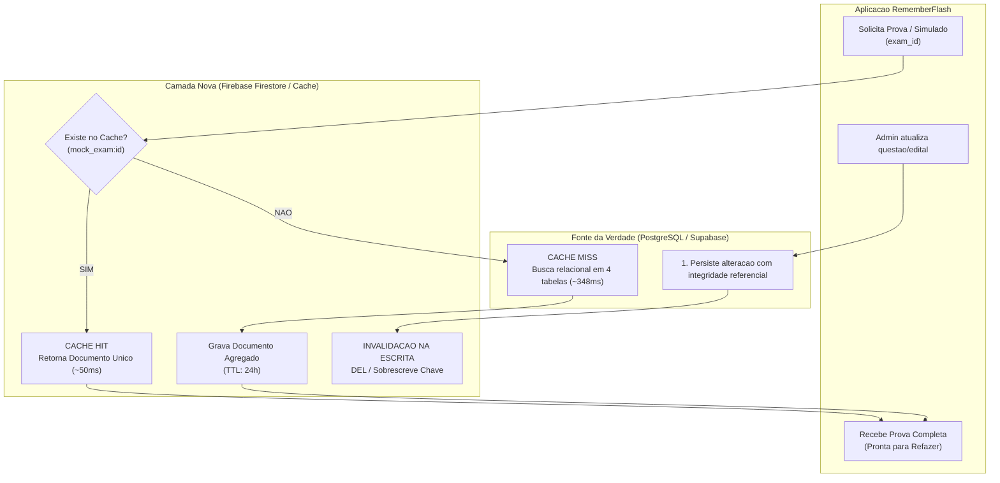

# UNIVERSIDADE DE RIO VERDE — UniRV
## Faculdade de Engenharia de Software
**Disciplina:** ESW441 — Tópicos Especiais em Banco de Dados  
**Turma:** A  
**Docente:** Prof. Me. Gustavo Martins Lima  
**Data:** 13 de Outubro de 2026  

---

# PROJETO N2 — SEMANA 2: MODELAGEM DA CAMADA

### Acadêmicos (Trio):
* **Gabriel de Oliveira Silva**
* **João Vitor Marques Braga**
* **Maria Eduarda Lira Lemes Braz**

---

## 1. Contexto e Retrospecto da Semana 1

* **Sistema Escolhido:** **RememberFlash** (Trabalho de Fim de Curso — TFC).
* **Descrição Geral:** Aplicativo móvel voltado para a preparação de estudantes para concursos públicos e exames de alto rendimento com simulados, flashcards e cronogramas.
* **Persistência Atual:** Banco relacional em duas camadas — **SQLite** (localmente via Room) e **PostgreSQL** (remotamente na nuvem hospedado via Supabase).
* **O Ponto de Dor Diagnosticado:**
  > *"Hoje o sistema precisa fazer de 4 a 5 requisições de rede encadeadas no PostgreSQL em nuvem para buscar o concurso, as disciplinas e as questões por conta das chaves estrangeiras (`contests` $\rightarrow$ `disciplines` $\rightarrow$ `topics` $\rightarrow$ `questions`), e isso leva em média **~348,50 ms por prova** e é frágil se a rede oscilar ao visualizar ou refazer um simulado em um novo dispositivo."*
* **Baseline Medido ("Antes"):** **348,50 ms por prova** ($N = 1.000$ repetições, payload de 180 KB a 220 KB com 200 questões).

---

## 2. Caminho Escolhido: Banco de Documentos (Firebase Cloud Firestore / NoSQL)

Entre os três caminhos apresentados (Arquivo, Documento e Chave-Valor), o trio confirmou o caminho de **Banco Não Relacional Baseado em Documentos**:

* **Tecnologia:** **Firebase Cloud Firestore**.
* **Motivação:** A consulta que dói no RememberFlash envolve uma entidade composta e com alta variabilidade (uma prova completa com dezenas de disciplinas e centenas de questões de múltipla escolha com alternativas e gabaritos). 
* **Regra de Ouro Aplicada:** *"O que muda junto e é consultado junto, fica junto no mesmo documento"*. 
* **Resultado Esperado:** A consulta relacional complexa de 4 a 5 requisições encadeadas se transforma em um **`findOne` atômico por ID de documento** (`db.collection("mock_exams").document(exam_id).get()`), com suporte nativo a cache local offline.

---

## 3. Desenho da Unidade de Dado

Em vez de espalhar uma prova em 4 tabelas relacionais com chaves estrangeiras, modelamos a prova inteira como uma **unidade agregada, autocontida e completa** (*Self-contained Document*).

### 3.1. Como a Unidade é Encontrada
* **Coleção:** `mock_exams`
* **Identificador Único (Chave):** `exam_id` (composta pelo padrão `contest_{contest_id}_exam_{exam_num}`, ex.: `contest_1_exam_full`)
* **Filtro/Consulta:** Busca direta por chave primária de documento em $O(1)$.
* **Índice Secundário:** Campo indexado `contest_id` e `user_id` para listagem rápida de provas disponíveis.

### 3.2. Estrutura do Documento NoSQL (JSON / Firestore)

```json
{
  "_id": "contest_1_exam_full",
  "contest_id": 1,
  "contest_title": "Concurso Público Nacional Unificado - Auditor Fiscal",
  "organizer_name": "FGV",
  "total_questions": 200,
  "time_limit_minutes": 240,
  "created_at": "2026-10-13T10:00:00Z",
  "updated_at": "2026-10-13T10:00:00Z",
  "version": 1,
  "questions": [
    {
      "question_id": 101,
      "discipline_id": 10,
      "discipline_name": "Direito Constitucional",
      "statement": "Acerca dos direitos e garantias fundamentais previstos na CF/88...",
      "options": [
        "A) A competência tributária é indelegável...",
        "B) É permitida a concessão de anistia fiscal por decreto...",
        "C) A imunidade recíproca impede a tributação de taxas...",
        "D) O princípio da anterioridade nonagesimal...",
        "E) A decadência tributária pode ter seu prazo..."
      ],
      "correct_index": 0,
      "explanation": "Conforme o artigo 150 da CF/88...",
      "source": "AI_GEMINI"
    }
  ],
  "attempts_summary": {
    "total_attempts": 3,
    "last_score": 168,
    "last_attempt_at": "2026-10-12T18:30:00Z"
  }
}
```

> **Subcoleção Aninhada para Histórico Detalhado:**  
> As resoluções e refações individuais do estudante ficam na subcoleção:  
> `mock_exams/contest_1_exam_full/attempts/{attempt_id}` contendo o mapa detalhado de respostas (`answers`), tempo por questão (`times`) e pontuação obtida.

---

## 4. Estratégia de Cache e Invalidação (O Ponto Mais Difícil)

Para garantir máxima velocidade de leitura e integridade entre os dados, adotou-se o padrão **Cache-Aside** combinado com duas camadas de proteção: **Invalidação na Escrita** e **TTL (Time-To-Live)**.

### 4.1. Fluxo de Leitura (Cache-Aside)
1. O aplicativo solicita a prova com a chave `mock_exam:contest_1_exam_full`.
2. **Consulta a Camada Nova (Cache / Documento Firestore):**
   * **Cache HIT:** O documento é encontrado na camada rápida. É retornado imediatamente ao app em **~50 ms** (ou **~1 ms** se já estiver no cache local do SDK).
   * **Cache MISS:** Se o documento não estiver na camada rápida ou tiver expirado:
     1. O sistema recorre à **Fonte da Verdade** (banco relacional PostgreSQL / Supabase);
     2. Executa a montagem da prova (as consultas relacionais);
     3. Grava o documento completo na camada nova;
     4. Retorna a prova para a aplicação.

### 4.2. Invalidação na Escrita (Write Invalidation)
Quando o professor/administrador altera o edital, adiciona novas questões ou altera o gabarito de uma questão:
1. **Regra de Ouro do Cache-Aside:** Grava a alteração primeiro na **Fonte da Verdade** (PostgreSQL).
2. Imediatamente após a confirmação da gravação, **apaga ou sobrescreve a chave na camada nova**:
   ```text
   DEL mock_exam:contest_1_exam_full
   ```
3. A próxima requisição gerará um **Cache MISS**, forçando a reconstrução com os dados atualizados.

### 4.3. TTL (Time-To-Live) como Rede de Segurança
Mesmo com a invalidação na escrita, define-se um **TTL de 86.400 segundos (24 horas)** no documento de cache:
* Como provas e editais não mudam a cada minuto, o TTL de 24 horas garante consistência eventual automática caso qualquer falha de rede impeça a execução do comando de deleção do cache no momento da escrita.

---

## 5. Diagrama de Arquitetura da Camada Nova

Abaixo está o fluxo operacional demonstrando os caminhos de **HIT**, **MISS** e **INVALIDAÇÃO NA ESCRITA**:



---

## 6. Resumo para Apresentação em Sala (Final da Aula)

Para apresentação em voz alta ao Professor Gustavo Martins Lima:

* **Caminho Escolhido:** **Banco de Documentos (Firebase Cloud Firestore / NoSQL)** com padrão **Cache-Aside**.
* **Unidade de Dado:** Documento único agregado contendo metadados, lista completa de 200 questões, alternativas e gabaritos (`mock_exams/{id}`). A consulta relacional complexa de 4 passos vira um `findOne` em $O(1)$.
* **Invalidação:** Padrão **Cache-Aside** — grava na fonte da verdade primeiro e apaga a chave do cache na escrita (`DEL`), com **TTL de 24 horas** como rede de segurança.
* **Frase Obrigatória:**  
  > ### *"Na semana que vem eu implemento isto!"*
